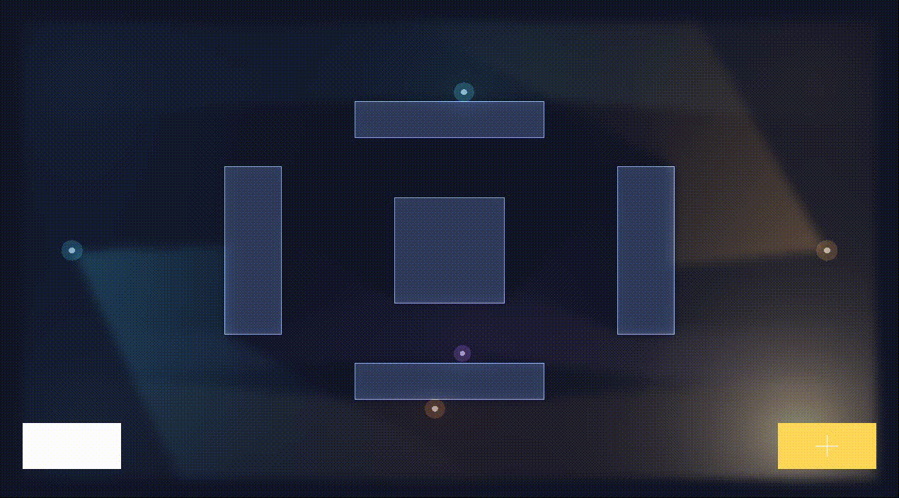

# 2D Dynamic Lighting Demo

Dynamic 2D lighting and shadow occlusion showcase built with **libGDX**, **Box2D**, and **Box2D Lights (`RayHandler`)**, using procedural geometry (`ShapeRenderer`) and touch/keyboard controls for **Desktop** and **Android**.

## Features & Technical Highlights

- **Real-Time Lights & Shadow Casting:** Combines directional cone lights and point lights with static occluder blocks and a pointer/touch-driven circular light.
- **Presets & Beam Controls:** Switch lighting presets and toggle the pointer light via on-screen touch buttons or keyboard shortcuts.
- **Zero External Assets:** Procedurally rendered geometry and lighting setup ready to compile on Desktop and Android.

## Running the Project

1. Clone the repository and ensure `box2dlights` is configured in your Gradle dependencies.
2. Run the **Desktop** target or deploy to **Android** to test touch input and lighting presets.

## License

This project is licensed under the MIT License. See the [LICENSE](LICENSE) file for details.

## Hire Us

Want atmospheric 2D lighting, technical art effects, or cross-platform game development from **Amphoteric Studio**?

- **Email:** info@amphotericstudio.com
- **Commercial Deck (PDF):** `[Commercial Deck PDF — Coming Soon]`
